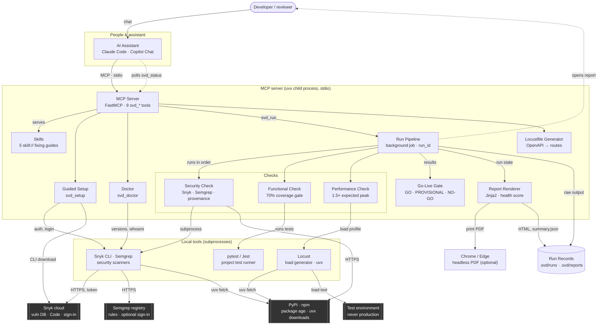

# System Architecture Diagram

This diagram shows Secure Vibe Delivery's internal components, the direction data flows
between them, and how it reaches its most important external dependency: **Snyk cloud**.

## How it connects to Snyk cloud

The server never calls Snyk's API itself. The Security Check starts the **Snyk CLI as a local
subprocess**, and the CLI talks to Snyk cloud over HTTPS with the token from a browser sign-in
done once in guided setup. Whether a scan runs therefore depends on the tool resolver finding the
CLI on that machine: on PATH, in the server's own cache, or (for Semgrep and Locust) through `uvx`.

## Diagram

**Reading the diagram:**

- Solid arrows = request/command direction; dashed = polling or a reverse-direction hand-back (the assistant polling a run, the report opening for the developer).
- Dark boxes = external systems Secure Vibe Delivery depends on but doesn't control.
- Everything inside "MCP server" runs in one local process; the local tools run as subprocesses of it.
